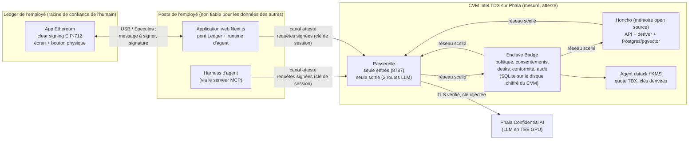
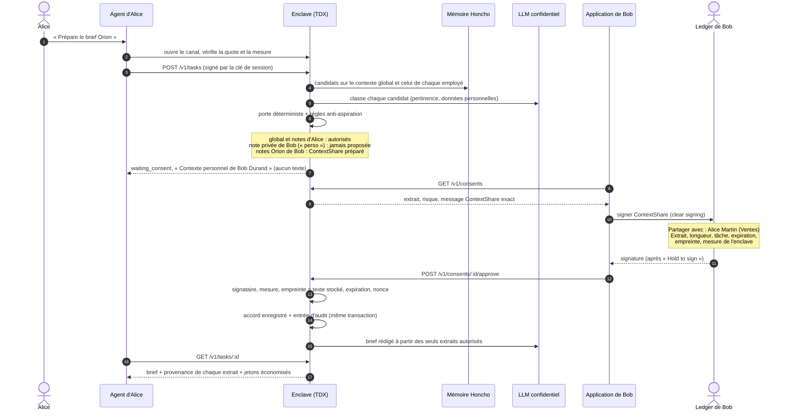
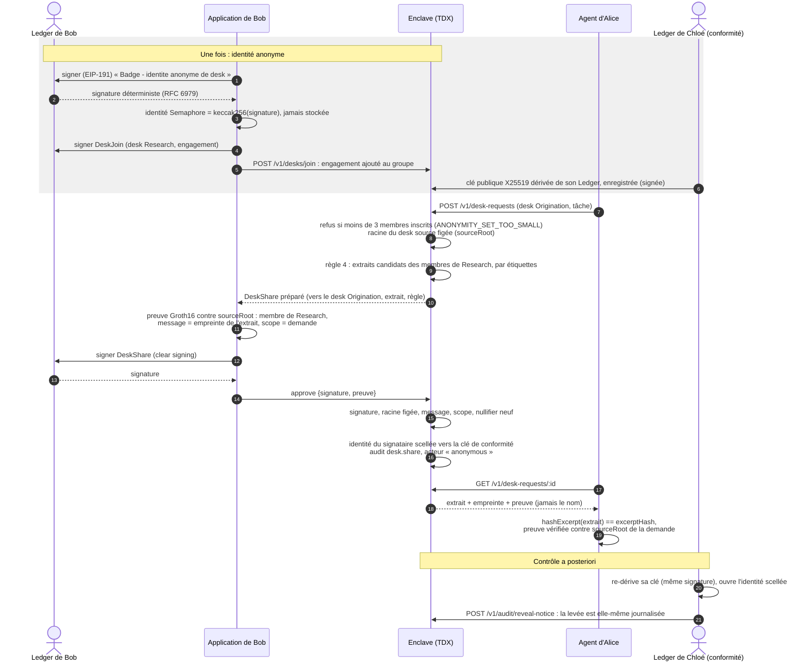

# Architecture de Badge

Badge est une couche mémoire d'entreprise pour les agents IA. Elle connaît le contexte **global** de l'entreprise
(ouvert à tous) et le contexte **personnel** de chaque employé (à lui seul), choisit le contexte utile à une tâche et
ne laisse sortir un extrait personnel de son périmètre qu'avec l'accord de son propriétaire, **signé sur son Ledger**.
Tout le traitement a lieu dans une enclave confidentielle (Intel TDX, Phala dstack) que chaque client vérifie avant
de lui parler.

Cette page décrit les composants et les frontières de confiance, les trois flux principaux, les messages signés, le
modèle de menace et ce qui reste à faire pour la production. Le contrat détaillé de l'API est dans
[`enclave-api.md`](enclave-api.md), le déploiement dans [`DEPLOY.md`](DEPLOY.md).

## 1. Composants et frontières de confiance

| Zone                  | Ce qu'on lui confie                                                                                                                              | Ce qu'elle ne peut pas faire                                                                                                                                |
| --------------------- | ------------------------------------------------------------------------------------------------------------------------------------------------ | ----------------------------------------------------------------------------------------------------------------------------------------------------------- |
| **Ledger**            | La clé de l'employé ; l'affichage de ce qui est réellement signé.                                                                                | Rien : il signe seulement ce que l'humain valide sur son écran.                                                                                             |
| **Poste / agent**     | Une **clé de session** déléguée une fois (`AgentSession`, 8 h dans la démo, 12 h au plus) : droit de _demander_ du contexte.                     | Lire le contexte d'un collègue sans son accord ; approuver un partage (seul le Ledger du propriétaire le peut) ; modifier un message préparé par l'enclave. |
| **CVM (enclave)**     | Tout le contexte, la politique, le journal. Code mesuré : son compose hash est dans chaque message signé et vérifié à chaque ouverture de canal. | Être modifié sans que la mesure change ; joindre Internet hors des deux routes LLM de la passerelle.                                                        |
| **Opérateur / cloud** | Faire tourner le CVM, lui transmettre quatre variables chiffrées vers sa clé KMS.                                                                | Lire la mémoire ou les clés (mémoire chiffrée TDX, secrets internes générés dans le CVM, journaux non publics).                                             |
| **LLM confidentiel**  | Les extraits nécessaires à une classification ou à un brief, via la passerelle.                                                                  | Être joint par autre chose que la passerelle ; recevoir un extrait non autorisé pour un brief.                                                              |

Principes communs à tous les paquets : **échec fermé** (toute vérification lève une erreur typée avec un code
stable), **une seule source de vérité** (messages EIP-712 dans `@badge/consent`, format filaire dans
`@badge/client`), et **un message signé n'a d'effet que dans une transaction** qui consomme son nonce, applique
l'effet et écrit l'entrée d'audit.

### Le canal attesté

Aucune donnée n'est envoyée à l'enclave avant qu'elle ait prouvé ce qu'elle est (`@badge/attest`) :

1. le client envoie un nonce et une clé X25519 éphémère ;
2. l'enclave répond avec sa clé publique et une **quote TDX** dont le `report_data` vaut
   `sha512(nonce || clientPk || enclavePk)`, l'event log et l'`app_compose` exact ;
3. le client vérifie la signature Intel DCAP et le TCB, rejoue les RTMR, compare le compose hash, l'app id, les
   mesures de l'image OS (MRTD, RTMR0-2) et le KMS aux valeurs épinglées, et seulement alors dérive les clés
   AES-256-GCM (une par sens, numéros de séquence stricts).

Ce chemin a été vérifié sur un **vrai CVM Phala** (quote Intel, TCB `UpToDate`, toutes les épingles, aller-retour
par le canal). Particularité gérée : un vrai CVM renvoie vides les digests des événements RTMR3 de son event log ; le
client les dérive de leur contenu, puis le rejeu doit reproduire le RTMR3 de la quote, ce qui authentifie ce contenu.

TLS se termine à la passerelle Phala : c'est ce canal, pas TLS, qui garantit la confidentialité jusqu'à l'enclave.
Dans chaque requête, la clé de session signe `méthode, chemin, horodatage, sha256(corps)` (EIP-191), avec contrôle
d'horloge (60 s) et cache anti-rejeu.

## 2. Flux : brief Orion avec accord ponctuel

Alice (Ventes) demande à son agent le brief de son rendez-vous avec le client Orion. Une partie du contexte utile est
dans les notes de Bob (Grands comptes).

Variantes du même flux :

- **Agent piégé** : l'agent demande « tout le contexte de Bob ». L'extrait unique « Tout le contexte de Bob Durand »
  déclenche l'alerte `FULL_CONTEXT_REQUEST` (montrée à Bob, journalisée `rule.warn`) ; au-delà de 8 000 caractères,
  la demande est bloquée avant même d'atteindre son Ledger. Bob refuse sur l'appareil : rien n'est livré.
- **Révocation** : l'enclave prépare le `ContextRevoke` exact (`POST /v1/revocations/prepare` : un accord, ou
  `grantId = 0x0` pour tout ce qui est partagé avec Alice) et son libellé nomme la portée réelle, accords d'équipe
  compris (« Tout ce que j'ai partage avec Alice Martin + accords equipe Ventes ») ; Bob le signe. L'enclave fait
  tourner la clé de données de Bob, puis enregistre la révocation ; un brief en cache qui utilisait
  l'extrait est rédigé à nouveau sans lui, et la tâche suivante redemande son accord.
- **Accord permanent** : Bob signe une fois `ContextPolicy` (« l'équipe Ventes peut utiliser mes notes `orion` pour
  des briefs clients, 500 caractères max, 30 jours »). Les demandes suivantes qui entrent dans ce cadre passent sans
  le solliciter, chaque usage est compté et journalisé (`policy.used`). Une demande signalée par les règles n'est
  jamais couverte par un accord permanent, et chaque libération est de nouveau contrôlée (données personnelles) sur
  le seul texte de l'extrait, pas sur une classification que la tâche pourrait influencer.

## 3. Flux : partage anonyme entre desks (mur de Chine)

Le desk Origination (Alice) a besoin d'un fait de marché détenu par le desk Research (Bob, David, Emma, chacun
inscrit avec son propre Ledger). Une règle d'échange
(« Regle 4 - marche capteurs ») autorise certains sujets à traverser le mur ; Alice doit apprendre **qu'un membre de
Research** a partagé l'extrait, pas lequel. Seule la conformité peut lever l'anonymat, avec une clé dérivée de son
propre Ledger.

Points clés :

- **ensemble d'anonymat minimal** : tant que le desk source compte moins de trois membres inscrits avec leur Ledger,
  l'enclave refuse la demande (`ANONYMITY_SET_TOO_SMALL`) ; aucun membre n'est préinscrit, chacun signe `DeskJoin` ;
- la racine du desk source est **figée à la demande** (`sourceRoot`) : chaque preuve est vérifiée contre elle, par
  l'enclave puis par le demandeur, avec l'empreinte de l'extrait reçu ; une preuve issue d'un autre groupe est
  refusée ;
- le nullifier n'est consommé qu'après tous les autres contrôles, pour qu'une preuve invalide ne puisse pas
  « brûler » celui d'un membre légitime ;
- le journal de conformité ne contient jamais de texte d'extrait (empreintes, longueurs, identifiants), et
  l'identité d'un partage de desk n'y figure que scellée.

## 4. Messages signés sur le Ledger

Domaine EIP-712 : `{ name: "Badge", version: "1", chainId: 1, verifyingContract: 0x…bad9 }`. Ce sont des messages
**hors chaîne** ; `chainId` et `verifyingContract` ne servent qu'à rattacher le descripteur de clear signing
(ERC-7730), qui exige ces deux champs.

| Message          | Intention affichée  | Champs affichés (dans cet ordre)                                              | Champs signés mais masqués                |
| ---------------- | ------------------- | ----------------------------------------------------------------------------- | ----------------------------------------- |
| `EmployeeEnroll` | Rejoindre Badge     | Entreprise, Identite, Equipe, Enclave                                         | `employee`, `issuedAt`, `nonce`           |
| `AgentSession`   | Autoriser mon agent | Agent, Acces (« Demander du contexte »), Expire le, Cle de l'agent            | `enclaveMeasurement`, `employee`, `nonce` |
| `ContextShare`   | Partager un extrait | Partager avec, Extrait, Longueur (car.), Tache, Expire le, Empreinte, Enclave | `recipient`, `owner`, `taskId`, `nonce`   |
| `ContextPolicy`  | Accord permanent    | Equipe autorisee, Contexte, Usage, Max par extrait, Expire le, Enclave        | `owner`, `nonce`                          |
| `ContextRevoke`  | Revoquer un acces   | Revoquer, Le                                                                  | `grantId`, `recipient`, `owner`, `nonce`  |
| `DeskJoin`       | Rejoindre un desk   | Desk, Entreprise, Identite anonyme                                            | `employee`, `nonce`                       |
| `DeskShare`      | Partage anonyme     | Vers le desk, Extrait, Longueur (car.), Regle, Expire le, Empreinte, Enclave  | `sourceDesk`, `requestId`, `nonce`        |

Trois messages EIP-191 (texte lisible, affiché tel quel par l'application Ethereum) complètent le tableau :
dérivation de l'identité anonyme de desk, dérivation de la clé de conformité, enregistrement de la clé publique de
conformité. Ceux de dérivation sont des **secrets** (clé = keccak256(signature)) : ils disent « Ne signez ce message
que dans Badge ».

Choix de conception :

- **Ordre des champs = ordre d'affichage.** Sur l'appareil (vérifié sur Speculos Flex), les champs s'affichent dans
  l'ordre de la structure, pas dans celui du descripteur. Chaque structure commence donc par les champs affichés, dans
  l'ordre de lecture, suivis des champs techniques. Un test d'invariant le vérifie pour chaque descripteur.
- **ASCII uniquement.** L'appareil n'affiche pas les accents : chaque chaîne affichée passe par `toDeviceAscii` et
  toute chaîne non ASCII est refusée **avant** signature. Un libellé illisible ne doit jamais être signé.
- **La mesure de l'enclave est affichée en entier** dans les messages qui engagent des données : un accord signé pour
  une autre version du code est refusé (`ENCLAVE_MISMATCH`).
- **L'empreinte de l'extrait** (keccak256 du texte) lie la signature au texte exact ; l'enclave la recalcule sur le
  texte qu'elle a stocké avant d'accepter la signature.
- **Horizons bornés** dans le contrat lui-même : partage ponctuel et partage de desk 7 jours au plus (24 h dans la
  démo), accord permanent 90 jours au plus, session d'agent plafonnée à 12 h par l'enclave, inscription valable
  10 minutes.

## 5. Modèle de menace

| Menace                                                   | Atténuations                                                                                                                                                                                                                                                                                                                                                                                                                                                                                                                                                                | Risque résiduel                                                                                                                                                                                                                                                                                                                         |
| -------------------------------------------------------- | --------------------------------------------------------------------------------------------------------------------------------------------------------------------------------------------------------------------------------------------------------------------------------------------------------------------------------------------------------------------------------------------------------------------------------------------------------------------------------------------------------------------------------------------------------------------------- | --------------------------------------------------------------------------------------------------------------------------------------------------------------------------------------------------------------------------------------------------------------------------------------------------------------------------------------- |
| **Agent malveillant ou piégé** (injection de prompt)     | La clé de session ne donne que le droit de demander. Sélection stricte des extraits d'un collègue (pertinence ≥ 0,7, pas de donnée personnelle, pas d'étiquette `perso` / `rh` / `confidentiel`). Règles déterministes. Chaque extrait d'un collègue exige une signature du propriétaire sur son Ledger, sur un écran que l'agent ne contrôle pas. Le brief est encadré comme des données, pas des instructions ; le serveur MCP présente tout libellé tiers comme une donnée citée, balises neutralisées.                                                                  | Ce que le propriétaire a accepté est livré à l'agent et peut ensuite être mal utilisé par lui. La pertinence est jugée par un LLM : la porte déterministe et la signature restent les vraies barrières. Dans la démo, la demande « tout le contexte » est modélisée par un champ explicite de l'API.                                    |
| **Aspiration massive**                                   | Seuils nommés (`src/policy/rules.ts`) : longueur d'extrait (alerte > 600, blocage > 8 000 car.), part du contexte du propriétaire (alerte ≥ 90 %), propriétaires par tâche (alerte ≥ 3, blocage > 6), demandes par propriétaire et par heure (alerte ≥ 20, blocage ≥ 60). Une alerte est montrée au propriétaire et journalisée ; un blocage n'atteint jamais son Ledger.                                                                                                                                                                                                   | Une exfiltration lente sous les seuils reste possible, mais chaque extrait exige un accord signé et chaque usage est journalisé.                                                                                                                                                                                                        |
| **Opérateur ou cloud curieux**                           | Mémoire chiffrée par TDX ; image et configuration mesurées (compose hash, images épinglées par digest) ; clients qui épinglent aussi app id, image OS (MRTD, RTMR0-2) et KMS, ce qui exclut une image de développement ; hôte LLM figé dans la compose attestée et dans l'image de la passerelle (seule la clé est un secret : le déployeur ne peut pas rediriger le contexte) ; secrets internes générés dans le CVM ; journaux et infos système non publics ; réseau scellé, une seule sortie vers le LLM confidentiel ; quote vérifiée par chaque client à chaque canal. | Confiance dans Intel TDX (et ses canaux auxiliaires), dans le KMS Phala et dans l'image OS dstack épinglée. Les extraits envoyés au LLM sortent du CVM vers le TEE GPU de Phala Confidential AI, dont Badge ne vérifie pas l'attestation à chaque appel.                                                                                |
| **Serveur web compromis** (pont Ledger, runtime d'agent) | Il détient des clés de session, pas les clés des employés. Il ne peut pas fabriquer une signature Ledger ; s'il altère le message préparé par l'enclave, la signature ne correspond plus et l'enclave la refuse. L'écran de l'appareil, non l'interface web, fait foi. Fichier des sessions en `600`, refusé s'il est lisible par d'autres.                                                                                                                                                                                                                                 | Il voit ce que voient les agents qu'il héberge (briefs livrés à son employé). Il peut afficher une interface trompeuse, mais pas changer ce que le Ledger montre. La dérivation de la clé de conformité passe par lui le temps d'une levée d'anonymat.                                                                                  |
| **Rejeu**                                                | Nonce aléatoire de 256 bits par message, consommé de façon atomique par signataire ; expiration dans chaque message ; mesure de l'enclave dans chaque message ; requêtes signées avec horodatage (± 60 s) et cache anti-rejeu qui échoue fermé ; numéros de séquence stricts dans le canal ; nullifier Semaphore par demande ; canaux jamais utilisés libérés et session résolue avant l'anti-rejeu, pour qu'un flot de requêtes ne sature ni la table des canaux ni le cache.                                                                                              | Aucun connu dans le périmètre du protocole.                                                                                                                                                                                                                                                                                             |
| **Accord révoqué**                                       | La révocation est un message signé, appliquée dans la même transaction que son entrée d'audit ; la clé de données du propriétaire tourne avant l'enregistrement ; les briefs en cache sont rédigés à nouveau sans l'extrait ; un accord permanent révoqué ne couvre plus rien.                                                                                                                                                                                                                                                                                              | Un extrait déjà livré ne peut pas être « repris » : la révocation protège l'avenir. La rotation de clé ne rend pas les anciennes données illisibles pour l'enclave (anciennes versions encore dérivables) : la garantie est portée par le moteur de politique.                                                                          |
| **Désanonymisation d'un desk**                           | Preuve d'appartenance Semaphore : le desk destinataire ne reçoit jamais le nom ; livraisons triées par empreinte ; identité scellée vers la seule clé de conformité ; chaque levée est journalisée.                                                                                                                                                                                                                                                                                                                                                                         | L'enclave connaît le signataire le temps de vérifier sa signature. Le contenu de l'extrait ou le moment de la réponse peuvent trahir l'auteur, et trois membres restent un petit groupe. Dans la démo, les trois membres de Research ont de vrais Ledgers (Speculos) mais des graines de test publiques : l'anonymat y est illustratif. |
| **Journal falsifié**                                     | Journal append-only (triggers SQLite), chaîné par sha256, vérifié en entier à chaque lecture par la conformité. Tête de chaîne signée par une clé de l'enclave dérivée du KMS ; le client de la conformité garde la dernière tête acceptée et refuse une lecture qui ne la prolonge pas (troncature, réécriture, autre signataire).                                                                                                                                                                                                                                         | La continuité n'est vérifiée qu'à partir de la première lecture d'un client ; un ancrage externe périodique de la tête signée la rendrait publique.                                                                                                                                                                                     |

## 6. Chemin vers la production

**Appareils réels**

- **Clear signing signé par Ledger** : la démo signe nos filtres EIP-712 avec la clé CAL de **test** publique
  d'app-ethereum, que seul Speculos accepte (un vrai appareil répond `6a80`). En production, nos descripteurs
  (`BADGE_DESCRIPTORS`, sous-ensemble d'ERC-7730) sont soumis au registre de clear signing et signés par Ledger ;
  le code de signature ne change pas, seule la source des filtres signés change.
- **Noms de contacts certifiés par l'appareil** : le carnet d'adresses (« Partager avec : Alice (Ventes) » certifié
  par HMAC de l'appareil plutôt que par un texte signé) est implémenté dans `@badge/ledger`, mais exige l'app Ethereum
  `develop` (1.23.0-dev, compilée depuis un commit épinglé). Il sera activable dès sa publication dans une version de
  l'app ; d'ici là, le nom du destinataire est un champ texte préparé et vérifié par l'enclave.
- **Délégation à l'agent** : `AgentSession` est notre propre message de délégation. Si Ledger publie un mécanisme
  standard d'intention d'agent ou de trousseau de clés de session (Agent Intent, Key Ring), Badge s'y alignera :
  l'enclave ne dépend que d'une signature vérifiable de l'employé sur une clé de session bornée dans le temps.

**Enclave réelle**

- Déploiement scripté sur un CVM Intel TDX de Phala (`docs/DEPLOY.md`) : `--no-dev-os --no-public-logs
--no-public-sysinfo`, KMS actif, images épinglées par digest, répétition locale complète avant toute dépense.
- Clients en mode `tdx` : signature Intel DCAP et TCB à jour obligatoires, **compose hash, app id, mesures de l'image
  OS (MRTD, RTMR0-2) et KMS épinglés** (`infra/cvm/expected-measurements.json`, publié dans le dépôt, capturé au
  déploiement). Fait sur un vrai CVM Phala : quote Intel vérifiée, TCB `UpToDate`, aller-retour par le canal
  attesté. L'application web n'accepte l'attestation simulée que pour une enclave en loopback.
- Publication reproductible : tout changement de `infra/cvm/compose.yml` change la mesure ; chaque version est
  redistribuée avec ses épingles, et les accords signés pour une ancienne mesure cessent d'être acceptés.

**Clés et séquestre**

- La clé de conformité est dérivée du Ledger de la responsable : rien à sauvegarder, mais une seule personne. En
  production, une politique de séquestre : plusieurs responsables avec partage à seuil (m sur n), rotation de la clé
  (une clé remplacée ne peut jamais redevenir courante), et levée d'anonymat soumise à double validation.
- Les clés de données par employé sont dérivées du KMS dstack et liées à l'application déployée ; la politique de
  mise à jour du code doit dire qui peut autoriser une nouvelle mesure à relire les données existantes.
- Ancrage externe périodique de la tête signée du journal de conformité, et annuaire alimenté par l'IdP de
  l'entreprise plutôt que par un fichier de démonstration.
